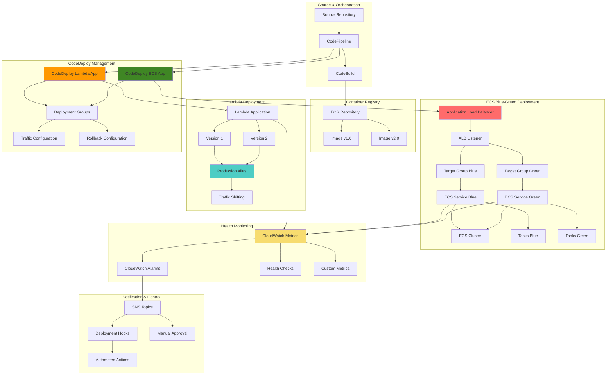

# Advanced Blue-Green Deployments with ECS, Lambda, and CodeDeploy

Zero-downtime blue-green deployments for containerized and serverless workloads on AWS, with automated health checks, traffic shifting, rollback triggers, and full deployment observability.

## Problem

Modern containerized applications require sophisticated deployment strategies that minimize downtime, reduce deployment risk, and enable rapid rollback. Traditional rolling deployments can lead to inconsistent application states, longer rollback times, and complex troubleshooting. Organizations need deployment strategies that support both containerized microservices (ECS) and serverless functions (Lambda) while providing comprehensive monitoring, automated rollback triggers, and CI/CD integration.

## Solution

AWS CodeDeploy provides advanced blue-green deployment capabilities for both ECS services and Lambda functions, enabling zero-downtime deployments with automatic traffic shifting and rollback mechanisms. This project demonstrates sophisticated blue-green deployment patterns with automated health checks, custom deployment hooks, intelligent traffic management, and comprehensive monitoring across multiple deployment targets within a unified workflow.

## Architecture

## Key Features

- **Blue-green deployments for ECS** — dual target groups behind an ALB with automatic traffic shifting between blue and green environments
- **Blue-green deployments for Lambda** — version-based traffic shifting through Lambda aliases with gradual rollout
- **Automated rollback** — CloudWatch alarms trigger CodeDeploy rollback on elevated 5XX rates, response times, errors, or duration
- **Deployment lifecycle hooks** — pre-deployment validation and post-deployment verification Lambda functions
- **Sample applications** — Express.js service with health, readiness, and Prometheus metrics endpoints, plus a Python Lambda API
- **Full observability** — CloudWatch metrics, alarms, SNS notifications, and custom deployment validation metrics

## AWS Services

| Service | Purpose |
|---|---|
| CodeDeploy | Orchestrates blue-green deployments for ECS and Lambda |
| ECS (Fargate) | Containerized application platform |
| Lambda | Serverless compute and deployment hooks |
| Application Load Balancer | Traffic routing between blue/green target groups |
| ECR | Container image registry |
| CloudWatch | Metrics, alarms, and automated rollback triggers |
| SNS | Deployment notifications |
| IAM | Least-privilege deployment and task roles |

## Prerequisites

1. AWS account with CodeDeploy, ECS, Lambda, ALB, and IAM permissions
2. AWS CLI v2 installed and configured (or AWS CloudShell)
3. Understanding of containerization, ECS services, and Lambda functions
4. Knowledge of blue-green deployment concepts and traffic shifting
5. Experience with Application Load Balancers and target groups
6. Estimated cost: **$30–60** for testing ALB, ECS tasks, Lambda executions, and monitoring

> **Note:** This project creates multiple AWS resources including ECS clusters, ALB, and Lambda functions. Monitor costs and clean up resources after testing to avoid ongoing charges.

## Implementation Overview

1. **VPC infrastructure and load balancer** — security groups, internet-facing ALB, blue/green target groups, and listener configuration
2. **IAM roles** — ECS execution/task roles, CodeDeploy service role, and Lambda execution role with least-privilege policies
3. **ECR repository and sample application** — Express.js app with health/metrics endpoints, multi-version Docker images (v1.0.0 and v2.0.0)
4. **ECS cluster and task definition** — Fargate service with health checks, structured logging, and ALB integration
5. **Lambda function** — versioned API backend with production alias and version-specific behavior
6. **CodeDeploy applications and deployment groups** — blue-green configuration with auto-rollback for both ECS and Lambda
7. **CloudWatch alarms** — error rate, response time, Lambda errors, and duration alarms wired to SNS for automated rollback
8. **Deployment automation** — pre-deployment validation and post-deployment verification lifecycle hooks

## Validation & Testing

- Verify ECS service health and target group registration during traffic shift
- Test Lambda alias traffic shifting between versions
- Trigger simulated errors via the `/error` endpoint to validate alarm-driven rollback
- Confirm pre/post-deployment hooks report success/failure back to CodeDeploy
- Monitor CloudWatch dashboards and SNS notifications throughout the deployment lifecycle

## Cleanup

Delete the CodeDeploy applications and deployment groups, ECS service and cluster, Lambda functions and aliases, ECR repository, ALB and target groups, CloudWatch alarms, SNS topics, and IAM roles to avoid ongoing charges. Full cleanup commands are documented in the implementation steps.

## License

This project is licensed under the [MIT License](LICENSE).
